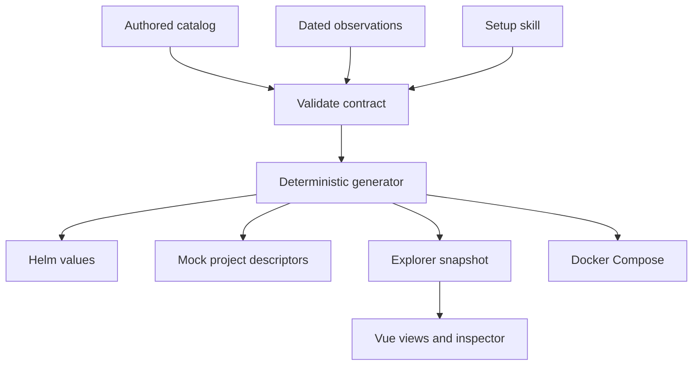

# Design and implementation plan

## Purpose

Archi answers: what belongs to this system, which services depend on each other,
where a service is deployed, and what evidence supports the displayed version?
Its first audience is a new teammate or architecture reviewer navigating multiple
repositories, Helm releases, pipelines and observability tools.

## Data flow



The graph is a projection of the contract. It is not stored inside a UI component.
Validation and generation have no network side effects. Local runtime and static
serving are separate modules. Tests exercise behavior at these boundaries.

## Repository structure

```text
config/                Authored intent and independent fictional observations
src/core/              Semantic validator, graph projection, generator, server
src/mock/              Shared Node HTTP simulator and image recipe
scripts/               CLI entrypoint
web/components/        Graph, inspector and environment comparison
web/vendor/            Pinned offline Vue runtime + license
charts/project/        Authored reusable Helm chart and values schema
examples/projects/     Generated multi-repo boundary descriptors
generated/helm/        Generated project/context values
.agents/skills/         Reusable configuration workflow
tests/                 Node tests and optional browser interaction gate
```

## Decisions

**JavaScript throughout.** Node built-ins cover file generation, test running and
mock HTTP servers. Vue's composition API and separate components keep UI state and
presentation small. No service backend or database is necessary for a deterministic
read-only architecture snapshot.

**Offline-first Vue build.** The pinned production runtime/compiler is available
locally and includes MIT licensing. ES modules avoid a mandatory package installation
or remote CDN at startup. This is a practical first-version build choice, not a ban
on tooling. At larger scale, migrate components to Vue SFCs and Vite, externalize the
vendor package to an exact lockfile and retain the core Node contract APIs.

**SVG graph.** Project/service nodes are keyed by identity; edges are derived from
relationships. The first fixture uses a readable curated layout. Automatic layout,
large-graph virtualization, drag editing and saved user layouts are later extensions;
the model must remain independent of any chosen graph library.

**Shared mock runtime.** Eight service descriptors and three project descriptors
exercise real dependency calls without duplicating business boilerplate. Docker
Compose runs a container per service; `npm run demo` runs independent HTTP servers
in one Node process. The topology and failure signals are simulated, not a load or
availability model.

**One Helm chart, nine values files.** Project boundaries are release boundaries;
contexts choose cluster and namespace. Cross-project links resolve through Kubernetes
Service DNS in that namespace. No cluster credentials, secrets, real registry images
or external telemetry integrations are embedded.

## System configuration workflow

1. Describe system boundaries and deployment contexts to the setup skill.
2. Resolve identities and ownership in authored config, retaining unknowns.
3. Validate references and deployment closure.
4. Generate Helm values, project descriptors, Compose and graph data together.
5. Run deterministic output checks, runtime tests and Helm/browser gates.
6. Review the explorer and generated diff. Follow the user's current Git/PR decision.

## Future integration boundaries

| Adapter | Produces | Must not assume |
|---|---|---|
| Helm renderer | workloads, Services, image references | service calls or business boundaries |
| Kubernetes collector | dated observed deployments/readiness | mutable tags prove source identity |
| CD pipeline reader | release → artifact → source evidence | every artifact uses a Git tag |
| Repo scanner | repo paths and declared ownership | one repo equals one service |
| Observability linker | scoped dashboard/log URLs | link presence implies live health |

Adapters should return candidate records with evidence and collection timestamps.
Keep authored declarations immutable during collection; reconcile through a diff.
Conflicting collectors should produce explicit unresolved claims, not last-writer-wins.
Credentials belong to the deployment environment and must not enter exported snapshots.

## Roadmap

1. Review the three views, fixture realism and identity model with Ping.
2. Add a Helm rendered-manifest importer with explicit unresolved fields.
3. Add CD artifact-to-source mapping using pipeline URLs and build metadata.
4. Introduce snapshot history and explicit freshness thresholds per collector.
5. Add larger graph layout, saved views and additional instance identity when needed.

Out of scope now: live traffic, complete version history, automated policy decisions,
real business logic, actual AMQP/gRPC transports and production deployment automation.
