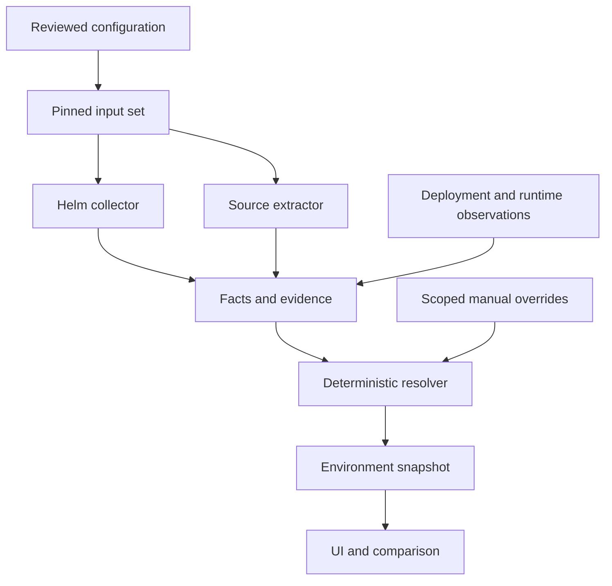

# Archi design review and next-direction report

Review date: 2026-09-17, Asia/Taipei. Baseline: `f61c61261827f6a1007aa2a03ba15abc434331dd`, branch `feat/architecture-poc`.

Inputs: the approved `archi-design-discussion-2026-09-17.md`, repository inspection, and seven isolated model probes. This report proposes the next design; it does not claim that the new ingestion pipeline has been implemented. No product behavior or PR is changed by this review.

## 1. Recommendation

Proceed with the direction in the design note. The next milestone should prove an **explainable, environment-scoped analysis pipeline**: pinned repository inputs → real Helm rendering and bounded source extraction → facts → resolution → snapshots → the existing UI.

Keep the JavaScript core, Vue UI, mock server, and synthetic demonstrations. The current implementation is useful as a presentation and simulation harness. Its authored architecture is not yet an independently discovered architecture, so expanding the graph UI first would leave the central product assumption untested.

The main adjustment is to make uncertainty a first-class output. An old observation, failed collector, disabled client, unresolved endpoint, and pending release are different situations. A single status enum cannot describe them reliably. The first implementation must preserve these distinctions before adding more analyzers.

The recommended first release boundary is one synthetic Spring application, one chart, two environments, three deliberately different clients, and a complete explanation for every included or excluded dependency. Production telemetry is not a prerequisite.

## 2. Findings from the existing implementation

These are gaps against the new target, not a claim that the original demonstration contract was invalid.

| Area | Current evidence | Consequence | Priority |
| --- | --- | --- | --- |
| Input direction | `src/core/generate.mjs` generates manifests and descriptors from `config/system.json` | Architecture is authored before deployment artifacts are generated | P0 |
| Helm ingestion | `scripts/archi.mjs` invokes lint/template, but does not ingest rendered stdout | A successful render does not produce architecture facts | P0 |
| Environment dependencies | `src/core/model.mjs` projects one global dependency list | Dev-only evidence and edges cannot be isolated correctly | P0 |
| Identity | One deployment per service/context; observations require a declared deployment | Cannot represent observed-only resources or multiple releases of one service | P0 |
| External systems | Dependency targets must be known services deployed in the context | Databases, SaaS endpoints, and cross-context dependencies are rejected | P0 |
| Comparison | Image, ready replica count, and known commits produce drift | Readiness, release progress, and spec divergence become conflated | P0 |
| Evidence | Edges reference evidence without a derivation graph; inspector includes fixed evidence presentation | Cannot reconstruct a code → config → endpoint → target decision | P0 |
| Freshness | Timestamp validity is checked, but projection has no freshness policy | Very old matching observations can remain aligned | P0 |
| Onboarding | Existing skill drives simulation configuration; scenario test adds a service deterministically | It verifies the generation workflow, not AI repository discovery | P1 |
| Graph generality | `web/components/GraphCanvas.mjs` includes fixture-specific positions | Arbitrary imported systems need a later layout pass | P2 |

### Reproduced behavior

The review loaded the existing JSON inputs, cloned them per case, and invoked `validate` / `projectGraph` without editing repository fixtures. These are observed outputs at the baseline commit.

| Probe | Actual result | Required future behavior |
| --- | --- | --- |
| Add an observation for an undeclared deployment | `orphan observation` | Preserve observed resource; logical-service mapping may remain unresolved |
| Add an external database dependency | `external-db: dangling dependency` | Preserve a typed external endpoint, without inventing an internal service |
| Add another instance of the same service/context | `duplicate service deployment in context` | Distinguish instance/release identity from logical service identity |
| Set matching observation time to `2020-01-01T00:00:00Z` | `status: aligned` | Retain the historical match, expose stale freshness, avoid claiming current alignment |
| Change ready replicas to zero while keeping the image | Drift reason `replicas` | Report health separately from desired/live spec comparison |
| Supply a different known observed SHA without release binding | Drift reason `commit` | Show a revision difference with unverified release correspondence |
| Inspect projected dependency scope | Eight global edges; no environment/context field | Resolve dependencies independently within each environment snapshot |

The existing [successful CI run](https://github.com/Ping-Lin/archi/actions/runs/35109124504) validates the existing PoC. It does not validate the proposed semantics, Java analysis, or ingestion design. This review did not rerun the full product suite because it changes documentation only.

## 3. Data flow and ownership

Separate four artifacts with explicit schema versions:

| Artifact | Owns | Must not become |
| --- | --- | --- |
| `archi.config.json` | Repository locations, environment mappings, chart inputs, supported rule selection, aliases and scope policies | A manually maintained duplicate of discovered dependencies |
| Input lock | Immutable repository SHAs, input hashes, chart dependencies, analyzer/tool versions and render context | A branch name treated as an immutable revision |
| Overrides | Assertion being overridden, replacement, environment, reason, author and expiry/review policy | Silent edits to generated facts |
| Analysis output | Evidence, facts, resolutions, coverage, snapshots and diagnostics | An input that the AI must rewrite every run |

Project labels and intentional aliases are legitimate configuration. Extracted service inventories and resolved dependency lists are output. Unknown configuration fields should fail schema validation; unsupported analysis should produce diagnostics rather than silently disappear.

The resolver should be a pure function over versioned inputs. Collectors perform I/O; the resolver never reads the filesystem, calls Git, or asks an LLM for a missing answer. Keep a CLI entry point for deterministic re-analysis without the onboarding skill.

### Minimal contracts

| Entity | Required fields or relationships |
| --- | --- |
| InputSet | Environment ID; repository-ID → commit-SHA vector; config hash; tool/rule versions; render parameters |
| Evidence | Type; input ID; immutable locator; content hash; environment/placement scope; collection time; redaction metadata |
| Fact | Predicate; subject; value/object; evidence IDs; extractor version; scope |
| AnalyzerResult | Status; inspected scope; coverage; facts; diagnostics; execution metadata |
| Resolution | Rule/version; input fact IDs; outcome; alternatives; reasons; override IDs if applied |
| Resource | Source or observed identity; placement; kind; selected spec; evidence; optional logical-service mapping |
| Dependency | Source instance/service; endpoint/target; protocol; environment; resolution IDs; independent evidence dimensions |
| Snapshot | InputSet reference; resource/dependency sets; coverage; semantic content hash |
| Run | Execution ID; start/end time; snapshot hash; diagnostics and tool exit status |

Facts and resolutions form an acyclic derivation graph. Every displayed dependency must lead back to evidence, including negative or unresolved outcomes. Stable IDs should use canonical scoped content, not array positions. Execution timestamps belong in the run envelope so identical inputs can yield identical semantic snapshot hashes.

## 4. Corrections to identity and environment modeling

### Environment is not a branch or cluster

An environment can span clusters, namespaces and repositories. A repository can provide different commits to different environments. Represent those relationships explicitly rather than embedding one branch and one cluster into the environment identity.

Git discovery can list candidate branches and inspect files, but branch naming alone is not proof of environment assignment. The onboarding proposal must explain its mapping and preserve unresolved associations. Resolve selected refs once into a revision vector, then analyze immutable content without changing the user's working checkout.

### Resource identity

For observed Kubernetes objects, use `(clusterId, API group, resource type, namespace, name)` as the object key and UID to identify an incarnation. Keep API version as representation metadata. Kubernetes identifies objects across API versions; including version in identity can duplicate a resource. [Kubernetes object identity](https://kubernetes.io/docs/concepts/overview/working-with-objects/names/)

For offline manifests, resolve kind-to-resource mapping through pinned discovery/schema metadata where available. Otherwise keep a provisional group/kind identity and mark its mapping unresolved. Cluster-scoped resources use an explicit empty namespace. A template with only `generateName` has no known observed-object identity yet.

Separate logical service, deployable instance, Kubernetes resource, and endpoint. One logical service may have stable/canary releases and multiple placements. An external endpoint may have no repository. A resource may have no known logical service. These are valid model states.

Represent gateway routing explicitly: caller → gateway, then route → backend with separate evidence. Do not turn network reachability or a possible route into a proven direct application call. Ambiguous aliases must preserve candidate targets rather than select the first match.

## 5. Evidence, absence, health and drift

### Independent dependency dimensions

Replace a single progression such as inferred → resolved → runtime-confirmed with separate dimensions:

| Dimension | Example values | Meaning |
| --- | --- | --- |
| Configuration eligibility | enabled / disabled / unknown | Supported registration/condition rules; not proof of execution reachability |
| Target resolution | unique / ambiguous / unresolved | Whether the endpoint maps to a specific target |
| Runtime support | observed / not observed in window / unavailable | What a scoped telemetry collection actually established |
| Consistency | compatible / conflicting / unevaluated | Whether comparable assertions agree |
| Freshness | fresh / stale / unknown | Assessment against an explicit policy and evaluation time |

No dev observation may confirm a production edge. No absence of traffic proves that a dependency is disabled. A static class reference is a candidate, not proof that an instantiated bean executes a request. Runtime disagreement must remain visible; it must not silently overwrite source facts.

### Absence requires coverage

Every collector must report success/partial/failure and its inspected scope. An empty successful namespace listing and an authentication failure cannot both mean “no resources.” Source-only and observed-only labels require a defined comparison boundary and sufficient collection coverage. Otherwise use “source present; deployment unknown” or the converse.

An observed-only resource need not be an error: another release, a manual resource, or an incomplete source inventory may explain it. Similarly, a rendered resource is not automatically deployed.

### Compare the right revisions and fields

Keep three views distinguishable: candidate source at branch HEAD, released artifact/source binding, and observed live state. A new commit waiting for release is a source-to-release difference, not automatically live drift. A commit in an image tag is not trustworthy release provenance. A digest identifies an artifact but still needs provenance to identify its source revision.

Allow comparison when selected baselines and lineage are explicit; otherwise report differences with unverified correspondence. Preserve observation time, collection scope and lineage in the UI. Do not collapse an old historical match into present health.

Compare canonical supported spec fields with field-specific policies. Ready replicas describe health; desired/live spec replicas describe configuration, and an HPA can legitimately own scaling. Rollout health, configured image tag, resolved image digest, and release revision should be separate fields. Avoid raw whole-document YAML equality because defaults, controllers and ordering produce misleading changes.

## 6. Helm and Spring analysis boundaries

### Helm

Use the real Helm binary and parse its rendered documents. Lock chart/dependency content, ordered values files, set values, release name, namespace, Kubernetes capabilities, Helm version and any post-renderer. Record which resource kinds were inspected and which were unsupported.

Local `helm template` does not establish live deployment state or server-side API validity; cluster lookups do not have ordinary live semantics during local rendering. Treat required cluster context as unavailable unless explicitly supplied through a separate controlled mode. [Helm template reference](https://v3.helm.sh/docs/helm/helm_template/)

Real Helm execution alone does not guarantee reproducibility. Charts can use time/randomness, external plugins or post-renderers. The first supported contract excludes uncontrolled inputs and reports nondeterministic output rather than promising stable hashes. Start with rendered Deployment and Service objects; retain unsupported documents and diagnostics. Hooks and CRDs need explicit inclusion and lifecycle policies before interpreting their absence.

### Bounded Java/Spring PoC

Start with explicit client construction/bean registration, literal configuration-key references, simple constructor injection, and a documented subset of profile/property conditions. Use a parser-backed extractor with source locations; select its implementation through a small syntax/correctness spike before committing to a parser dependency. Keep the public core contracts in JavaScript. A future language-specific helper can implement the same extractor protocol if necessary.

Handle known YAML/properties inputs, explicit profiles and the declared deployment property sources. Spring property precedence includes sources beyond repository files; external/profile-specific configuration and imports can override defaults. If a relevant higher-priority source is unavailable, qualify or leave the effective value unresolved. [Spring external configuration](https://docs.spring.io/spring-boot/reference/features/external-config.html)

For the first slice, reflection, dynamic factories, arbitrary expressions, remote configuration, custom registration and unsupported conditions return diagnostics/unknown. Do not claim to support arbitrary Spring applications or determine general program reachability. Extending a known convention may require only configuration; supporting a new framework or semantic construct may require a new extractor/rule.

## 7. Smallest complete fixture and acceptance oracle

Use one application containing clients A/B/C, one Helm chart and independent dev/prod inputs. Hand-author expected facts, candidate dispositions and edges before implementing extraction. Reusing the generator's own output as the only expected result would test self-consistency instead of correctness.

| Candidate | Source/config setup | Dev expectation | Prod expectation |
| --- | --- | --- | --- |
| A | Explicit client registration and endpoint key; environment-specific gateway URL | Enabled; unique gateway target; separate route evidence when supplied | Enabled; independently resolved production target; runtime unavailable |
| B | Registration guarded by a supported dev-only profile | Enabled; unique target; optional dev runtime evidence | Disabled by explicit profile evaluation; retain exclusion explanation |
| C | Registration guarded by a supported property explicitly false in both environments | Disabled, no active edge | Disabled, no active edge |

Keep an unused legacy client class as an additional candidate. Mere lack of an observed call or detected injection must not be presented as a proven disabled registration.

The milestone passes only if an operator can select an edge and inspect its source location, registration condition, config key, effective value and precedence, endpoint mapping, rule version, input revision and environment. Disabled candidates and unresolved cases must also be inspectable.

Required adversarial acceptance cases:

1. Change only dev values: dev resolution changes; prod semantic snapshot does not.
2. Remove the active endpoint value or introduce an unsupported override: resolution becomes unknown with a reason, never a guessed service.
3. Add two matching target aliases: retain ambiguity and both candidates.
4. Add an external database and a second release: preserve both without violating identity constraints.
5. Add a stale Helm resource and an observed-only resource: distinguish source presence, observed presence and collection coverage.
6. Fail a collector or deny access: do not conclude absence.
7. Supply stale or contradictory observations: preserve age and disagreement; dev evidence does not cross into prod.
8. Change ready replicas during a rollout: health changes independently from spec drift.
9. Advance source HEAD without a verified release binding: display a revision difference, not confirmed runtime drift.
10. Repeat locked deterministic inputs: canonical snapshot hashes match; run timestamps may differ.
11. Use unsupported Spring syntax or Helm context: emit a scoped diagnostic and retain the unresolved candidate.
12. Remove runtime input entirely: production source/config analysis still completes with explicit limitations.

## 8. Onboarding skill design

The existing skill is a useful seed, but its contract should distinguish `demo` generation from `analyze` onboarding.

The proposed workflow is: inspect an approved repository scope; inventory conventions and candidate environment mappings; propose versioned config and rule selections with evidence; validate schemas and render inputs; present the proposal for review; execute deterministic analysis; produce unresolved-items and coverage reports; verify a second run needs no AI.

The skill should persist reviewed configuration, input-lock policy, selected analyzer versions and validation results. It should not author “facts” to fill unsupported gaps. Overrides remain explicit and separately reviewed. A newly proposed analyzer or executable rule is code requiring review, not harmless configuration.

The skill acceptance suite needs both deterministic configuration tests and real onboarding evaluations on unfamiliar synthetic repository layouts. Evaluate correct mappings, unsupported-pattern disclosure, and successful re-analysis without an LLM. The existing scripted ninth-service scenario should remain, but must not be described as proof of autonomous onboarding.

All company source, private deployment inputs and resulting potentially sensitive architecture stay inside the approved internal boundary. Configuration and derived graphs can also disclose internal information; they are not automatically safe exports. Use synthetic fixtures for public development. Scope file access and commands; do not execute arbitrary instructions discovered in repository text.

## 9. Incremental implementation plan

The following are proposed repository tasks, not already-created GitHub issues. They are ordered by dependencies rather than calendar estimates.

| Task | Depends on | Scope / proposed location | Acceptance gate |
| --- | --- | --- | --- |
| D01: Freeze v2 contracts | — | `docs/model-v2.md`, schemas under `src/analysis/` | Identity, coverage, evidence dimensions, baseline comparison and canonical hashing specified with examples |
| D02: Build independent fixture oracle | D01 | `tests/fixtures/analysis/` | A/B/C and failure cases have hand-authored expected outcomes |
| D03: Pin and render inputs | D01, D02 | `src/analysis/inputs/`, `src/analysis/collectors/helm.mjs` | Two independent env inputs; real output parsed; lock and diagnostics retained |
| D04: Implement bounded extraction and resolution | D01, D02 | `src/analysis/extractors/`, `src/analysis/resolvers/` | Supported source → config → endpoint chain works; unsupported patterns remain unknown |
| D05: Produce snapshots and explanations | D03, D04 | Snapshot projection plus existing inspector/compare components | Environment isolation, stable hashes, exclusion explanations and evidence navigation pass |
| D06: Update onboarding skill | D05 | `.agents/skills/archi-system-design/` | Unfamiliar synthetic repo can be configured, reviewed and rerun without AI |
| D07: Add observation/release adapters | D05 | Versioned deployment/ArgoCD/runtime adapters | Coverage, freshness and verified/unverified lineage behave correctly |
| D08: Generalize layout and more frameworks | D06, D07 | UI layout and additional analyzer packages | Driven by concrete unsupported patterns from internal pilots |

**First milestone is D01–D05.** D06 is the next validation of reuse. D07 must not be required to demonstrate production analysis without telemetry. D08 waits for evidence from real onboarding friction.

Retain the v1 demo commands and fixtures while adding a separate analysis command. A v1 compatibility adapter may label authored declarations as declared evidence, but must never relabel them as code-derived or live observations. Reuse UI components behind a projection adapter. Preserve the existing CI gates and add focused analysis-oracle tests; avoid a whole-system rewrite.

Defer persistent databases, generalized plugin marketplaces, broad framework coverage, autonomous deployment and graph-library replacement until the first milestone passes. This keeps the next iteration focused on correctness and explanation.

## 10. Decisions and remaining questions

| Item | Proposed disposition | What closes it |
| --- | --- | --- |
| JavaScript/Vue foundation | Retain | No demonstrated constraint warrants a framework rewrite |
| Dependency status model | Adopt independent dimensions | D01 examples and D02 oracle |
| API version in resource key | Remove; preserve as metadata | Identity tests across served versions |
| AI in steady-state analysis | Exclude | Deterministic second-run acceptance |
| Environment branch mapping | Explicit reviewed mapping after discovery | First internal repo convention inventory |
| Release/source provenance | Unknown until an adapter establishes it | Inventory available digest/build/ArgoCD metadata; do not infer from tag |
| Spring parser and supported subset | Bounded spike before selection | Parser handles fixture locations/conditions; unsupported syntax is detected |
| Freshness thresholds | Configurable by evidence type/environment | Internal collection cadence and expected lag are known |
| Gateway attribution | Explicit route evidence, otherwise unresolved backend | Obtain a supported route source and scope contract |
| Overrides | Scoped with reason and review/expiry policy | Agree ownership during first pilot onboarding |
| Real repository pilot | Internal-only after synthetic milestone | Approved access and a repository representing actual conventions |

No unresolved question above blocks writing the synthetic contracts and fixtures. Avoid inventing operational defaults that would imply stronger certainty than the available evidence.

## 11. Go/no-go criteria for the next direction

Continue toward internal onboarding when the two-environment slice produces correct independent results, every included/excluded edge is explainable, missing information remains visible, and reruns are deterministic without AI. Then measure onboarding configuration changes, analyzer-code changes, unresolved patterns and manual overrides on an internal pilot.

If common repository patterns repeatedly require hardcoded core changes, narrow the advertised support or improve the adapter boundary before scaling. If explanations cannot identify why an edge exists, pause UI expansion and fix the fact/resolution model. If source-to-release correspondence is unavailable, ship clearly labeled source/config architecture first and leave runtime-drift claims out of that release.

The intended outcome is a trustworthy architecture analysis product that can explain its limits. A larger diagram is useful only after those limits are explicit.
