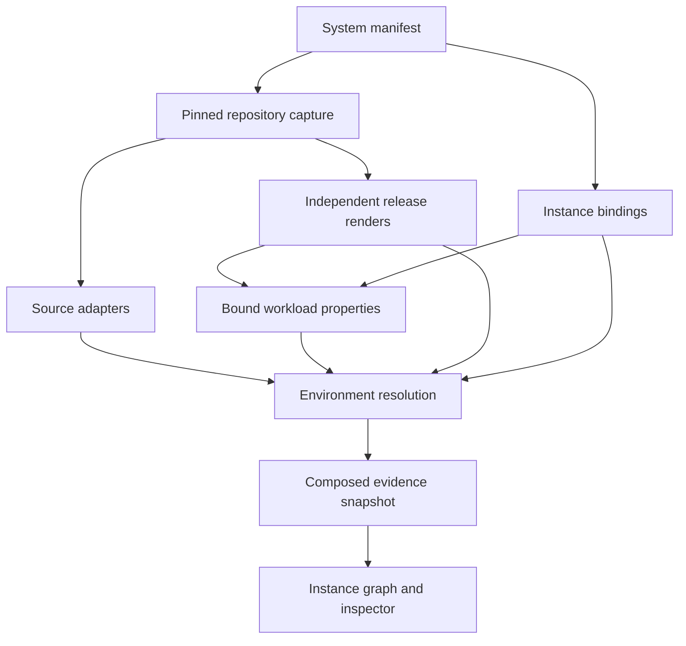

# System composition — archi/system-v1alpha1

Opt-in typed client `/2` adapters support unique relaxed member names. See
[relaxed binding](relaxed-client-binding.md).

`spring-bean-client/1` supports explicit mutable String properties beans. See
[bean consumption](bean-client-binding.md).

`spring-record-client/1` connects explicitly registered String properties records
to HTTP client base URLs. See [record consumption](record-client-binding.md).

`spring-feign/1` adds explicit Feign interface registration and configured URL
evidence under a reviewed-defaults policy. See [Feign clients](feign-clients.md).

`spring-http-factory/1` adds opt-in bounded Java RestClient/WebClient base-URL
extraction. See [HTTP client factories](http-client-factories.md) and the
[prioritized common-feature plan](common-feature-plan.md).

`spring-properties/10` adds bounded multi-document profile activation to repository
and mounted input scopes. See [configuration documents](config-documents.md).

`spring-properties/8` adds explicit repository profile variants; `/9` composes them
with mounted profiles. See [profile configuration](profile-configuration.md) and
[mounted profiles](mounted-configuration.md#mounted-profiles-opt-in-9).

`spring-properties/7` adds explicit import bindings between captured mounted files;
see [mounted imports](mounted-configuration.md#mounted-imports-opt-in-7).

`spring-properties/6` adds explicit mounted ConfigMap files; see
[mounted configuration](mounted-configuration.md).

`spring-properties/5` adds approved import file bindings to capture and input locks;
see [explicit ConfigData imports](config-imports.md).

`spring-properties/4` adds scoped rendered ConfigMap environment resolution and
opaque Secret references. See [ConfigMap bindings](configmap-environment.md).

Additive `ai-evidence/3` supports reviewed gRPC host/port and DNS bindings through
`grpc-endpoint/1`. Instance endpoints can explicitly declare `gRPC`; identity is
still scoped to rendered Service/Deployment evidence. Transport security is
unknown, not inferred from TCP or the target string. See [gRPC endpoints](grpc-endpoints.md).

Status: implemented pinned-input scope, with maintained synthetic fixtures. This extends the existing analysis pipeline;
the original v2 single-repository configurations and their CLI remain supported.

## Responsibilities

| Contract | Executable implementation | Boundary |
| --- | --- | --- |
| Adapter | `src/analysis/adapters.mjs` | Closed versioned built-ins, result schemas, extraction and diagnostics |
| Binding | `src/analysis/system-contract.mjs` | Strict manifest schema, project/service/instance/release identities and references |
| Resolution | `src/analysis/bindings.mjs` | `deployment-endpoint/1`: endpoint to scoped instance, with binding and rendered evidence |
| Capture | `src/analysis/repositories.mjs` | Read explicitly pinned local Git objects; capture and hash approved source/config files |
| Composition | `src/analysis/system-run.mjs` | Render each release, analyze each instance, combine evidence and produce existing UI snapshots |

Adapters are `spring-explicit-bean/1`, `ai-evidence/1`, `spring-properties/1` and `helm-template/1`.
Additive opt-ins `ai-evidence/2` and `spring-properties/2` support structured endpoint
bindings and ordered properties/YAML with explicit env mappings. See
[configuration bindings](configuration-bindings.md) for schemas and limitations.
`spring-properties/3` additionally resolves bounded exact-key placeholders after
overrides, with transitive provenance and explicit default-use evidence. This is
an opt-in closed-source-scope contract; it does not implement all Spring semantics.
The opt-in [AI candidate adapter](ai-candidates.md) accepts evidence-bound proposals
with scoped operator reviews; it is not a general language parser. Unreviewed or
rejected proposals never create edges. Property and endpoint semantics retain their
existing supported boundaries.
Their runtime result schemas enforce required candidate/property/resource fields,
coverage and diagnostics where applicable. Existing source syntax restrictions
still apply. There is no arbitrary executable plugin loading or config rule DSL.
Binding configuration selects inputs and reviewed mappings; it does not list edges.

## Manifest structure

The following is a field guide, not a runnable manifest. The generated fixture
provides a complete validated example with real commit SHAs.

| Field | Meaning |
| --- | --- |
| `schemaVersion`, `simulation`, `name` | Requires `archi/system-v1alpha1` and an explicit boolean simulation flag; fixtures use true, real source baselines use false |
| `repositories[]` | Unique `id`, local `path` relative to CLI root, full 40-character commit `revision` |
| `projects[]` | Ownership ID and display name |
| `services[]` | Logical service ID, project ID, source adapter, repository-qualified files and client types |
| `environments[].releases[]` | Release ID, cluster, namespace, Helm release name, chart/value file references and pinned render capabilities |
| `environments[].instances[]` | Instance ID, logical service, release, exact Deployment name, optional Service endpoint and independent property/profile policy |
| `environments[].externalTargets[]` | Explicit external endpoint IDs and URLs |

File references use `{ "repository": "orders", "path": "Clients.java" }`.
An instance's endpoint uses `{ "name": "api", "port": 8080,
"protocol": "HTTP", "kind": "service" }`, or null when it exposes no mapped
inbound endpoint. `propertyFiles` is ordered, repository-qualified YAML input.
`propertiesComplete` remains a reviewed assumption, not discovered live truth.

All names and identities are explicit. Duplicate instances, duplicate workload
ownership, duplicate release scopes, unknown references/adapters, unknown fields,
unsafe file paths and branch names in revision fields are rejected. Repository
paths must identify actual repository roots, not folders inside a parent repository.
Git symlink/submodule inputs are rejected. Capture does not clone, fetch or checkout.

## Capture and resolution flow



Each repository is read from its exact commit, ignoring dirty working-tree files
and Git replacement objects. Chart and values may be in a different repository
from Java sources. Every release is rendered twice using Helm v3.17.3; existing
nondeterminism restrictions apply. Resource identity includes cluster, API group,
kind, namespace and name. Two releases claiming the same resource fail the run.

The source adapter uses the instance ID as its analysis identity; property resolution
selects the explicitly bound Deployment resource key. Two instances of one logical
service can use the same source file and bean name without sharing candidate IDs.

Internal endpoint resolution requires:

1. Matching protocol/port and Kubernetes Service DNS within the caller's cluster.
   Short Service names are restricted to the caller namespace.
2. An explicit target instance binding in the selected environment.
3. A rendered Service and bound Deployment in the specified release/namespace.
4. A matching TCP Service port and nonempty Service selector matching the bound
   Deployment's pod-template labels.

These checks establish a supported source/config relationship, not network reachability
or successful live routing. Container listening ports, EndpointSlices, mesh routing,
network policies and cross-cluster routing are outside this rule. Gateway targets do
not imply backend routes. External aliases need explicit declarations; conflicting
aliases preserve alternatives and produce no unique edge. Missing bindings or missing
render evidence stay unresolved, rather than being joined by service name alone.

## Output, provenance and compatibility

Snapshots retain the existing analysis schema and evidence chain. New fields expose
projects, logical services, instances and release scopes. Candidate/edge `source` and
`target` identify instances (or explicit external targets); `sourceService`,
`sourceProject`, `targetService` and `targetProject` retain logical ownership.
The UI shows instance nodes, a pinned-repositories panel and binding details.

Each environment lock includes the used repository revision vector, scoped semantic
manifest hash, selected file provenance/hashes, adapter descriptors and release render
hashes. Local repository locations are acquisition details and excluded from semantic
hashes. Environment-only binding changes do not alter other environments' hashes.
Changing a shared pinned repository revision changes every environment using that repo,
even if the particular selected file bytes happen to remain identical.

Method evidence carries repository, commit and file provenance. Render evidence retains
release identity and pinned chart/value references; the input lock enumerates all
captured chart files. Resolutions expose `deployment-endpoint/1` and their input facts.
Assessment time remains outside semantic hashes.

This first system manifest uses **one repository revision vector per run**. Use separate
manifests when QA and production need different revisions of the same repository.
Automatic CD discovery, per-environment revision overrides, remote acquisition and
verified release provenance are not implemented. System-mode candidate-specific
runtime/deployment observations remain unavailable, and release correspondence
remains unverified. The additive [traffic layer](traffic.md) imports offline Istio
metrics and OTLP traces to reconcile workload relationships separately. Legacy v2
fixture observations still work.

The additive [runtime inventory layer](runtime-enrichment.md) reconciles scoped
Deployment/ReplicaSet/Pod captures separately. System-mode real baselines now accept
`simulation: false`; the flag participates in input locks and cannot be mixed with
synthetic captures. This enables a reviewed real-input path, not broader parser
coverage or verified production provenance. Historical synthetic-only descriptions
in earlier phase reports apply to their original milestones.

## Reproduce

```bash
npm ci --ignore-scripts
# Put Helm v3.17.3 on PATH.
npm run fixture:cross-repo -- artifacts/cross-repo-demo
npm run analyze -- --root artifacts/cross-repo-demo --system system.json \
  --oracle ../../tests/fixtures/cross-repo-oracle.json --out ../analysis
npm run dev
# Open /?view=analysis
```

The fixture command creates four new local repositories from committed specimens
and writes `system.json` with their real commit SHAs. It refuses to overwrite an
existing destination; choose a new directory for another run. Existing fixtures
can be reanalyzed without recreation. `--system` cannot be combined with the legacy
`--config` or `--revision` flags because its manifest owns the input revision vector.
