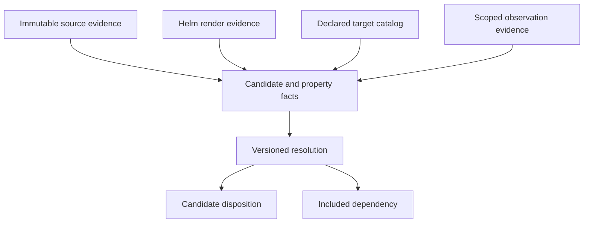

# Analysis contract — archi/analysis-v2alpha1

For the additive cross-repository system manifest and adapter/binding/resolution
contracts, see [system composition](model-composition.md). The configurations below
remain supported as the original single-repository mode.

This is the implemented **synthetic vertical slice**, alongside the unchanged [v1 demo contract](model.md). It is not a general Spring analyzer or a production collector. The configuration currently requires `simulation: true`.

## Run and inspect

Requires Node.js 22+, Git, npm dependencies, and Helm **v3.17.3**.

```bash
npm ci --ignore-scripts
npm run check:analysis
npm run dev
# Open http://127.0.0.1:4173/?view=analysis
```

`HELM_BIN` can select an installed Helm executable. `npm run analyze` writes `artifacts/analysis/analysis.json`, `input-lock.json`, and each environment's rendered YAML. The explorer serves only the analysis JSON through its explicit `/analysis.json` endpoint; it does not expose the artifacts directory. The original demo does not need these analysis dependencies to start.

```bash
# Freeze all selected inputs at a real commit, ignoring workspace edits:
npm run analyze -- --revision HEAD

# Use an explicit assessment time to inspect the dated synthetic observations:
npm run analyze -- --at 2026-09-17T03:00:00Z

# Analyze another synthetic config and write to a separate location:
npm run analyze -- --config examples/analysis/archi.config.json --out artifacts/experiment
```

The UI reads the default output path. After a failed analysis, a previous successful output may remain; its assessment timestamp and input lock identify that earlier run. No live cluster is contacted or deployed.

## Modules and contracts

| Module | Responsibility |
| --- | --- |
| `src/analysis/contract.mjs` | Strict executable config schema, canonical hashes, scoped ledger and referential validation |
| `src/analysis/inputs.mjs` | Capture approved paths or read immutable Git objects; materialize captured chart bytes |
| `src/analysis/helm.mjs` | Execute pinned Helm, detect differing repeated renders, parse resource documents |
| `src/analysis/spring.mjs` | Traverse Java CST, retain bounded candidates, resolve supported property sources |
| `src/analysis/resolve.mjs` | Pure candidate resolution, scoped fixture observations, resource comparison and freshness assessment |
| `src/analysis/run.mjs` | Orchestration, per-environment locks, snapshots, outputs and independent oracle check |

Configuration selects source files, the logical caller, approved client-constructor types, chart/render capabilities, environments, ordered values/property files, profiles and target aliases. `propertiesComplete` is an explicit reviewed assumption about the supported property-source boundary, not a discovered assertion about a live process. Unknown fields, duplicate environment/target IDs, non-synthetic mode and unsafe catalog URLs fail validation.

The target catalog is labeled **declared evidence**. Internal targets additionally need a matching rendered Service name, scoped DNS name and port. External endpoints do not require an invented Kubernetes service. Gateway resolution stops at the gateway; backend route extraction is deferred.

## Input locks and reproducibility

Default mode captures working-tree bytes once, records hashes and labels them `captured-working-tree`. Its HEAD SHA is contextual metadata, not a claim that dirty files belong to that commit. `--revision REF` resolves a commit once, then uses Git object reads without checkout or working-tree mutation. This slice supports one repository/revision per run and independently scoped environment inputs; multi-repository revision vectors and automatic branch discovery are deferred.

Each environment lock includes selected input-file hashes, scoped config hash, render hash, tool/rule versions and source mode. Changes to another environment's values do not affect this environment's lock. A new shared repository commit changes the revision metadata even if a particular environment's file contents are unchanged.

The materialized chart uses the captured bytes, not a second read of the working tree. External path traversal and symlink escapes are rejected. Capture is not an atomic filesystem snapshot across concurrent edits; use Git revision mode when that guarantee matters.

Snapshot IDs use canonical scoped content. `contentHash` covers the snapshot before that field is added. Run/assessment time and derived freshness sit outside the semantic snapshot, so advancing the assessment clock does not change its hash. Arrays preserve meaningful order, including property precedence. This is deterministic for the supported fixture inputs, not a claim of arbitrary Helm hermeticity.

## Evidence graph



Every ledger record has an environment and content-derived ID. Facts reference evidence IDs; resolutions reference fact IDs; candidates and dependencies reference resolutions. `assertSnapshot` rejects dangling references and cross-environment ledger records. Source evidence retains file/line location; property facts retain precedence and locator; render evidence retains a content hash. The inspector exposes all input facts and their evidence, including declared assumptions.

A resolution uses `spring-explicit-bean/1`. Changing semantic rules requires changing the version. This alpha has no general rule language, persisted override mechanism, or arbitrary executable plugin hooks.

## Supported Spring subset

Java is parsed using the pinned `java-parser` CST implementation. Matching occurs on parser-produced method structures/tokens, not free-text class-name searches. [Parser project](https://github.com/jhipster/prettier-java/tree/main/packages/java-parser)

The current eligible factory pattern requires:

- One normal class per configured file, explicitly annotated `@Configuration` with the corresponding explicit Spring import; no inheritance or additional class annotations.
- A method returning a configured client type and explicit `@Bean` without annotation arguments.
- Exactly one `String` parameter with literal `@Value("${key}")` and explicit Spring import.
- Exactly `return new ApprovedClient(parameter);` in the method body.
- Optional method `@Profile("literal-profile")`, or `@ConditionalOnProperty(name = "literal.key", havingValue = "literal-value")`, with explicit imports. Other forms, argument ordering, aliases, arrays, expressions and `matchIfMissing` are unsupported in this version.

Property conditions compare values without case sensitivity; missing values do not match. The implemented subset intentionally excludes Spring's broader annotation variants. [Spring property-condition contract](https://docs.spring.io/spring-boot/api/java/org/springframework/boot/autoconfigure/condition/ConditionalOnProperty.html)

Client-related factory methods without supported registration remain **unknown**, including the legacy fixture. Duplicate bean names remain unknown. Parse failures and unsupported locations emit diagnostics. Coverage means candidate analysis within the listed files; it does not cover the whole application or prove runtime reachability. The fixture Java files are source-analysis specimens, not a compiled or executed Spring application.

Supported property precedence is the reviewed ordered YAML mappings, then `SPRING_APPLICATION_JSON` on the single selected application container. The workload's rendered `SPRING_PROFILES_ACTIVE` must match reviewed profiles. The adapter refuses to establish complete properties for unsupported imports, profile directives, placeholders/expressions, unknown environment variables, `valueFrom`, `envFrom`, mounted configuration or command/args. Real Spring has more property sources; the adapter does not infer their absence. [Spring external configuration](https://docs.spring.io/spring-boot/reference/features/external-config.html)

Multiple deployable instances are valid resource inventory entries. If more than one workload matches the logical caller, the property adapter reports ambiguity; per-instance dependency resolution remains future work.

## Candidate and dependency states

| Field | Values / semantics |
| --- | --- |
| `eligibility` | `enabled`, `disabled`, `unknown`: supported registration/configuration conditions, not execution |
| `targetResolution` | `unique`, `ambiguous`, `unresolved`: endpoint mapping outcome |
| `runtimeSupport` | `observed`, `unavailable`: this fixture adapter makes no negative traffic claim |
| `consistency` | `compatible`, `conflicting`, `unevaluated`: comparable assertions remain visible |
| Assessment `freshness` | `fresh`, `stale`, `unknown`; one-hour demo threshold, future timestamps unknown |

Only enabled candidates with a unique target produce dependencies. A disabled candidate may still have a known configured target. Runtime disagreement does not silently rewrite the source/config result. Dev observations are never attached to prod records. Old observations keep their historical assertion, with stale freshness displayed separately.

## Resource and observation semantics

Supported render identities are `(cluster, API group, resource type, namespace, name)` for Deployment, Service and ConfigMap. API version is representation metadata; observed UID identifies an incarnation. Other kinds, hooks and generated names remain unsupported diagnostics; raw rendered output is retained. [Kubernetes identity](https://kubernetes.io/docs/concepts/overview/working-with-objects/names/)

Helm is executed locally, twice per environment. A version mismatch, timeout, render failure or differing repeated output fails the run. Known context/random functions are conservatively rejected. Binary dependency archives and arbitrary post-renderers are outside this contract. Unknown kinds make resource coverage partial. Local rendering does not perform server-side validation or establish live deployment. [Helm template](https://v3.helm.sh/docs/helm/helm_template/)

Observations are synthetic JSON with an explicit environment, namespace-scoped resource list, coverage and collection time. Invalid or failed collections cannot establish absence. An observed-only object is valid within the selected source comparison boundary. In production, absent observation input yields `source-present; deployment-unknown`.

Deployment comparison currently covers container names/images only. It reports a **difference**, not verified release drift. Readiness is separate health; replica values remain informational because controller/HPA ownership is unknown. Service/ConfigMap field comparison, image digest provenance and verified source-to-release correspondence are not implemented. No source SHA is inferred from image tags.

## Acceptance and next boundary

`tests/fixtures/analysis-oracle.json` is independently authored. `npm run check:analysis` compares the real pipeline against it. `tests/analysis/pipeline.test.mjs` covers deterministic capture, pinned revisions, environment isolation, unresolved/ambiguous/disabled cases, scope failures, identity, stale/conflicting observations and release uncertainty. CI requires Helm; local integration tests explicitly skip if it is absent, so skips do not represent a completed Helm gate.

`tests/analysis-browser.mjs` exercises evidence navigation, exclusions, production isolation, comparison, resource health, export and mobile layout. The skill now routes v1 simulation and v2 analysis onboarding separately. The logistics fixture validates configuration portability across a second layout; this is not a blinded autonomous-onboarding evaluation.

## Phase two: service graph and configuration portability

The Evidence lab opens on **Service graph**. Its view-only projection uses the
selected snapshot's resolved dependencies, validates their candidate/resolution
references, and never adds edges from disabled candidates or runtime observations.
Click or keyboard-activate an edge to inspect its exact candidate and evidence.
Disabled/unknown candidates remain selectable below the graph without active edges.
Search filters the view only. Gateway nodes do not imply undiscovered backend routes.

The graph represents the analyzed scope, not an exhaustive repository or cluster
topology. Single-caller configs remain supported alongside the multi-caller mode below. External
targets have a distinct node style; conflicting evidence has a dashed amber edge.
Generic deterministic source/target positioning replaces fixture-specific coordinates
for this projection. Large-graph layout optimization remains future work.

Run `npm run analyze:logistics` to analyze the second fixture into the standard
output and refresh the UI. Restore the checkout fixture with `npm run check:analysis`.
The second layout changes Java source path, constructor type, logical service,
chart location, values paths, property keys and environment names. No extractor or
resolver changes are required. Its dynamic factory deliberately remains unknown.
`tests/analysis/onboarding.test.mjs` checks a handwritten oracle and AI-free reruns.
`tests/graph-browser.mjs` checks both fixtures, environment switching, keyboard edge
selection, exclusions, empty search and mobile containment.

## Phase three: multiple callers in a shared render

`npm run analyze:system` analyzes `examples/system/archi.config.json`. This additive
alpha configuration form replaces `source` with `sources`. Each environment replaces
its top-level profiles/propertyFiles/propertiesComplete/observations with a `callers`
array that provides those fields for every source service. Mixing forms, missing or
duplicate caller scopes, duplicate service identities and reused observation paths
are rejected. A caller cannot also be declared as an external endpoint.

All callers share one repository capture/revision and one chart render per
environment. Source service labels select exactly one Deployment; supported internal
targets still require matching Service/DNS/port evidence. This is not a multi-repo,
multi-namespace, multi-release or per-instance composition contract.

Candidate IDs now include the logical source service, even when multiple callers
share the same Java file and bean name. Caller-specific ledger records include
`caller`; shared render facts remain common. Snapshot validation rejects duplicate
candidate IDs and cross-caller explanations/facts. Composition requires equal
environment and input locks. Hashes change with this identity extension; existing
persisted alpha snapshots should be regenerated.

Each caller resolves only its own properties and observations. `observations` and
resource comparisons retain caller provenance. The aggregate observation is
conservatively partial (or unavailable when every caller lacks input), with no
invented aggregate timestamp or release. Per-candidate freshness remains available.
Environment comparison keys on `(source, bean name)` rather than bean name alone.
Oracle keys in this mode are `service/beanName`.

The graph places multi-caller dependencies top-down, groups cycles before ranking,
preserves disconnected callers, and routes parallel edges separately. It creates
no transitive or inferred gateway edges. This deterministic small-system layout is
not a general-purpose optimizer for dense graphs.
