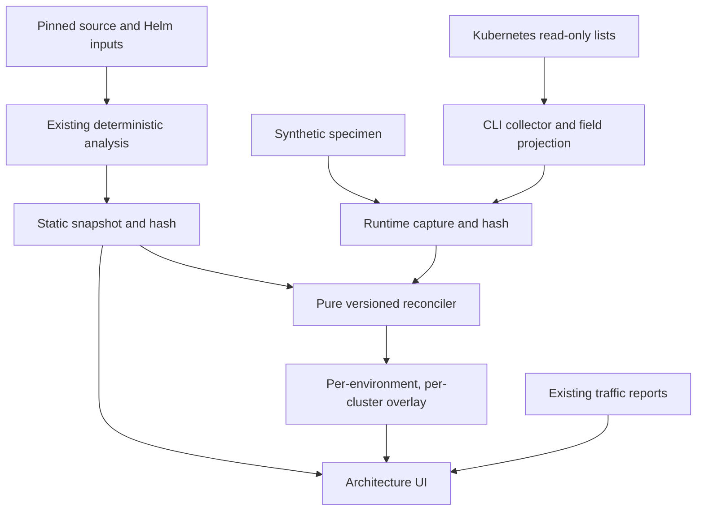

# Deployment runtime enrichment

Implemented on the existing feature branch. This is a bounded Deployment inventory
slice, not an observability platform or production deployment approval. The design
reconciles the 2026-09-24 runtime-enrichment proposal against existing system
identities and the independent Istio/OTLP traffic layer.

## Architecture and contracts



| Module | Responsibility |
| --- | --- |
| `src/runtime/contract.mjs` | Strict normalized capture schema, limits, hash and semantic validation; allowlisted Kubernetes projection |
| `src/runtime/collect.mjs` | Explicit namespace/context lists through kubectl; bounded pagination and sanitized partial failures |
| `src/runtime/reconcile.mjs` | `deployment-runtime/2`, independent status dimensions and evidence references |
| `src/runtime/import.mjs` | Attach one cluster report without replacing other clusters, environments, static snapshots or traffic |
| `src/observations/file.mjs` | Shared locked atomic analysis update used by traffic and runtime importers |
| `src/observations/create.mjs` | Exclusive, atomically installed owner-only capture files |
| `web/components/RuntimePanel.mjs` | Inventory, three-state inspector, reasons, capture scope and provenance |

`archi/runtime-capture-v1alpha1` contains one environment and one operator-asserted
cluster ID, context, capture interval and per-namespace/per-kind collections.
Kinds are Deployment, ReplicaSet and Pod. Every collection records status, reason,
list resourceVersion and its own collection interval. The v1 selector is always
null: collection covers the entire explicitly selected namespace for that kind.
No namespace discovery or fuzzy workload matching is performed.

`archi/runtime-report-v1alpha1` locks the static snapshot hash, capture hash, rule
version, assessment timestamp and TTL. `analysis.runtime[environment]` contains a
hashed `archi/runtime-overlay-v1alpha1` with one report per cluster. A subsequent
import replaces only that cluster's report. This is latest-import state, not history;
an operator can deliberately import an older capture, which remains dated/stale.

Reconciliation never rewrites static nodes, dependencies, candidate runtime fields,
or static hashes. Unbound runtime Deployments appear only in the inventory table.
Traffic edges still describe observations for a workload pair/protocol, not a Java
method or source revision. Export includes independently hashed snapshot, traffic
and runtime artifacts. Retain capture files alongside reports for reproduction.

## Interpretation rules

Three distinct states remain visible:

1. **Selected repository render:** a comparison baseline, not proven production intent.
2. **Live workload spec at capture:** Kubernetes' desired Deployment container references.
3. **Observed Pods:** per-Pod image references, reported container image IDs and readiness.

Container images are compared by container name. A reference difference is reported
even when a Deployment is available. Equal tags or digest strings only establish
matching references; no registry resolution, image-index/platform equivalence or
binary/source provenance is claimed. Init/ephemeral containers and their images are
outside this first comparison. Regular sidecars remain distinct named containers.

| Dimension | Meaning |
| --- | --- |
| `presence` | present / absent / unknown within the capture scope |
| `specAlignment` | matching / different / unknown for supported container references |
| `rollout` | complete / progressing / paused / unknown based on controller status |
| `availability` | available / degraded / unavailable / scaled-to-zero / unknown |
| `freshness` | fresh / stale / unknown at an explicit assessment time |
| `acquisition` | complete / partial / failed for relevant resource collections |
| `podCoverage` | completeness of ReplicaSet and Pod lists, not proven ownership of every Pod |
| `classification` | information / needs-verification / reported-failure, always at capture |
| `consistency` | bounded count checks; unknown / no-discrepancy-detected / needs-verification |
| `reportedFailures` | explicit current-generation Deployment conditions with original reason and evidence ID |

Presence is absent only after a complete unfiltered Deployment list. A failed or
uncollected namespace never proves absence. UID and controller owner references
join Deployment → ReplicaSet → Pod within a namespace; old Deployment UIDs cannot
inherit new ownership based on names. Unattached Pods are not guessed into a service.
Cluster IDs remain operator assertions, not authenticated tenant boundaries.

Availability uses the Deployment controller's counts after observedGeneration
catches up with generation. Missing counts stay unknown. Zero desired replicas have
their own state; replicas are not compared against Helm as drift because HPA/scaling
ownership is unknown. Rollout completion needs matching desired, total, updated and
available counts, and no reported failed Progressing condition. Mixed Pod references
and spec differences are reported separately. Collection is not atomic across kinds;
controller status and Pod observations can describe different moments. Availability
is not an end-to-end application health claim.

Version differences, mixed Pod versions, rollback and independently timed CD are
informational. They never establish an error. A current-generation, non-terminating
Deployment qualifies as `reported-failure` only with `Progressing=False` and
`reason=ProgressDeadlineExceeded`, or `ReplicaFailure=True`. Other conditions remain
in the capture; no Helm root cause is inferred. A reported failure can coexist with
available old replicas. A stale report describes a historical failure, not a current one.

With complete lists and an observed, non-terminating Deployment generation, compare
reported total replicas with linked non-terminating Pods. Also compare each observed,
non-terminating ReplicaSet's total with its owned non-terminating Pods. Missing counts
are skipped. Each check retains collection/object evidence IDs. Discrepancies mean
`needs-verification`, because resource lists and controllers are asynchronous; they
do not prove deployment failure. Incomplete collections leave consistency unknown.
`no-discrepancy-detected` applies only to the executed count checks, not authenticity,
readiness, image identity, orphan resources or complete cluster correctness.

Version 2 adds these fields without changing capture format. Reimport a retained
capture to recompute under the new rule. Older reports retain their original hashes;
the UI shows their new assessment fields as not assessed.

See [CD scenarios and review](runtime-consistency-review.md) for the T0–T6 oracle,
review findings and manual deployment acceptance boundary.

Freshness conservatively starts at collection start. Future-dated captures are
unknown. Reports are deterministic for the same static snapshot, capture, assessment
time and TTL; the browser additionally advances display freshness every 30 seconds.
Stale findings retain their historical status with capture timestamps. There is no
background cluster polling, watch, cache, probe or automatic diagnosis.

## Reproduce and QA

Use Node 22+, Git and Helm v3.17.3. Choose new fixture/capture paths; creation refuses
existing files. The UI reads the usual `artifacts/analysis/analysis.json`.

```bash
npm ci --ignore-scripts
npm run fixture:cross-repo -- artifacts/runtime-system
npm run analyze -- --root artifacts/runtime-system --system system.json \
  --oracle ../../tests/fixtures/cross-repo-oracle.json --out ../analysis
node scripts/traffic-fixture.mjs artifacts/runtime-traffic/bundle.json
npm run traffic -- --analysis artifacts/analysis/analysis.json \
  --bundle artifacts/runtime-traffic/bundle.json --out artifacts/analysis/analysis.json
node scripts/runtime-fixture.mjs artifacts/runtime-capture.json
npm run runtime -- --analysis artifacts/analysis/analysis.json \
  --capture artifacts/runtime-capture.json --out artifacts/analysis/analysis.json \
  --at 2026-09-24T12:00:00Z --ttl 300
npm run dev
# Open /?view=analysis, then Runtime inventory or a graph runtime badge.
```

| QA case | Expected result |
| --- | --- |
| portal | matching references; complete controller rollout; image identity unverified |
| orders | baseline `synthetic`, spec `previous`, Pods `older` and `previous`; available AND progressing AND different |
| inventory | absent within complete stock-qa Deployment list |
| orders-shadow | unknown presence; failed sandbox-qa acquisition |
| production | no runtime capture; no QA observations attached |
| Graph | four runtime badges; static edges unchanged; existing traffic highlights preserved |
| Export | snapshot, traffic, runtime envelope and cluster report hashes all recompute |
| Time | fixed historical capture becomes stale in the UI; never labeled live |

Automated coverage includes stale hashes, invalid schema/types, duplicate identities,
cross-environment/cluster rejection, owner UID recreation, missing/partial collections,
pagination/version failures, redaction, controller generation, zero replicas, paused
rollouts, shared writer locks and independent overlay preservation.

## Real source baseline and read-only capture

System-mode manifests now accept explicit `simulation: false` for real pinned
source/configuration inputs. The flag participates in the manifest/input hashes and
is carried into the analysis envelope. Legacy v1/v2 fixtures remain synthetic-only.
This removes a contract restriction; it does not broaden supported Java/Helm syntax
or certify discovery completeness. Never relabel synthetic specimens to match a real
capture. Reconcile only real baseline + real capture, or synthetic + synthetic.

Prepare and review real instance bindings first, then run system analysis with the
existing `--system` CLI. Each cluster name in the manifest must explicitly correspond
to the selected kubeconfig context. Only the operator can establish this mapping in
this version. No connection, permission or deployment is performed by analysis.

```bash
# Use an existing, private local directory. These are example arguments, not a
# checked connection or an instruction to use an arbitrary current context.
npm run runtime:capture -- \
  --environment staging --cluster commerce \
  --context company-staging --kubeconfig /approved/path/kubeconfig \
  --namespaces experience-staging,sales-staging \
  --out /private/captures/staging-001.json

npm run runtime -- --analysis artifacts/analysis/analysis.json \
  --capture /private/captures/staging-001.json \
  --out artifacts/analysis/analysis.json --at 2026-09-24T12:05:00Z
```

The collector uses the locally installed compatible kubectl, delegating approved
kubeconfig authentication to the operator's existing toolchain. This avoids a second
credential implementation/dependency. It only executes fixed `get --raw` list paths
with argument arrays, an explicit context and kubeconfig. Kubeconfig credential exec
plugins may execute local programs: use trusted operator-provided configuration only.
No write/exec/logs/Secret API, insecure TLS override, registry lookup or discovery
outside selected namespaces is invoked. Respect the kubectl/server compatibility
policy for the target cluster; no particular server version was live-tested here.

Bounds: 16 namespaces, 3 resource kinds, 500 requested records/page, 100 pages/list,
8 MiB/page, 32 MiB cumulative response bytes, 50,000 records, 15-second request limit
and 120-second overall collection budget. JSON depth/node limits also apply. A failed
page preserves previously collected valid records as partial and never claims
complete coverage. Changing list resourceVersion or repeated continuation tokens
fail the collection. Expired pagination is not silently restarted into a mixed list.
Exit status: 0 complete, 2 saved partial/failed capture, 1 invalid input/output failure.

Only resource identity/version, owner references, regular container references,
selected status counts/conditions and readiness are persisted. Environment values,
commands, args, annotations, labels and free-text status messages are omitted.
Raw API responses are transient process memory; read-only list permissions still
allow the credential holder to read full workload/Pod objects. RBAC is not field-level
redaction, and runtime capture files still contain sensitive infrastructure metadata.

Minimum namespace Role (bind using your platform's approved identity/process):

```yaml
apiVersion: rbac.authorization.k8s.io/v1
kind: Role
metadata:
  name: archi-runtime-reader
  namespace: sales-staging
rules:
  - apiGroups: [apps]
    resources: [deployments, replicasets]
    verbs: [list]
  - apiGroups: [""]
    resources: [pods]
    verbs: [list]
```

Create a Role/RoleBinding per approved namespace; no cluster-wide grant is necessary.
This example is documentation only and has not been applied.

## Operating limits and next acceptance gate

Use trusted private local POSIX directories supporting exclusive creation, hard links,
atomic rename and fsync. New capture installation refuses any existing destination.
Import uses the same canonical output lock as traffic, verifies existing hashes,
rechecks the input and installs atomically. Parent directories must not be writable
by untrusted users. Do not concurrently regenerate analysis outside this shared lock.
Inspect process ownership before manual crash-lock/temp recovery. A crash between
capture installation and temporary-link cleanup can leave an extra hard link; inspect
and remove the orphan temporary link before import. NFS/distributed writers are not
supported. Files use mode 0600; grant separate UI readers access deliberately.

Static analysis artifacts can contain source/configuration values. Use the explorer
locally with approved inputs; this change supplies no authenticated hosted service,
tenant isolation, retention service or sanitized public publishing workflow.

Still deferred: live-cluster acceptance, performance ceilings on representative data,
crash injection on the target filesystem, authenticated cluster identity, registry
digest equivalence, real metrics/trace acquisition, deployment provenance, StatefulSet
and DaemonSet health, init containers, endpoint inventory, generic external links and
active probes. The next acceptance gate is an explicitly scoped real-cluster capture
and known-rollout comparison, not production deployment of the demo server.

Primary references: [Deployment API](https://kubernetes.io/docs/reference/kubernetes-api/workload-resources/deployment-v1/),
[paginated lists](https://kubernetes.io/docs/reference/using-api/api-concepts/),
[kubectl get](https://kubernetes.io/docs/reference/kubectl/generated/kubectl_get/).
